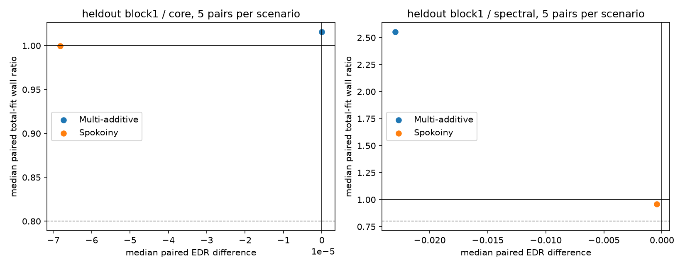
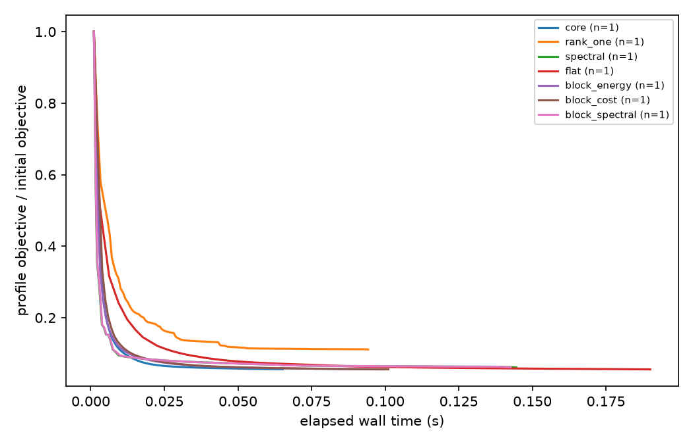
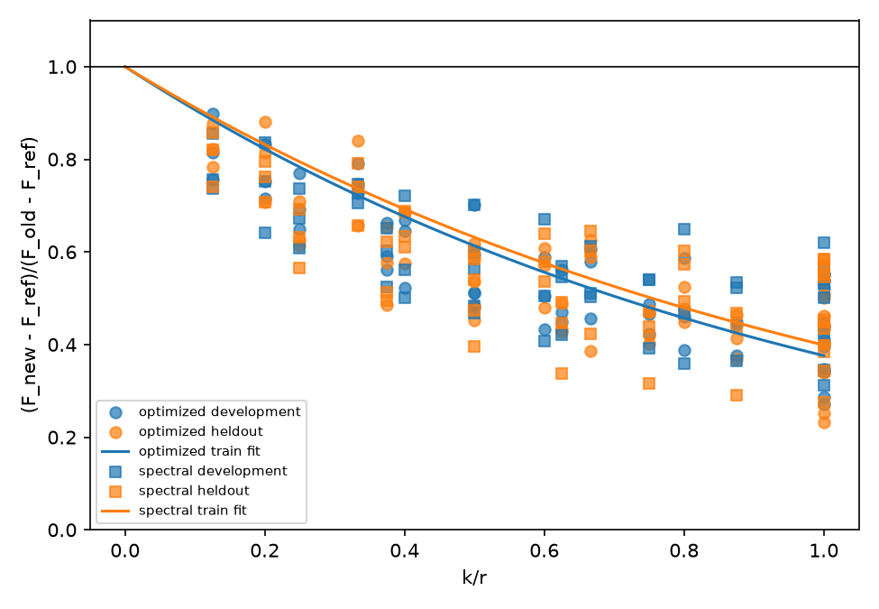

# Rank-k Grassmann: эксперимент 2026-10-16

Статус: завершено. Экспериментальный solver реализован; преимущество полного
EDR-восстановления не подтверждено. На отложенных seed медианное время
выбранного кандидата составляет 99,96% времени core_gn, а требовалось ≤80%.
Рост k улучшает одношаговый профильный функционал, но этого недостаточно
для ускорения полного fit. Основной solver сохранён.

## Что именно реализовано

Публичный экспериментальный вход `ADP.solver.grassman.block_rank_k` совместим
с callback `ADP_solver` и возвращает текущий `HPAOResult`. Обычный
`grassman.solve` сохраняет прежний `core_gn`; его AST проверяется против HEAD.

`spectral` уже реализует совместный геодезический шаг с общим параметром;
`flat_gn` уже оптимизирует несколько взаимодействующих углов на основе
профильного Jacobian. Поэтому новый метод переиспользует эти вычисления.
Экспериментальные отличия — фиксированный/адаптивный выбор ранга и ограничение
совместной задачи двумя GN-шагами вместо восьми у прежнего `flat_gn`.

Стратегия энергии выбирает минимальный ранг с долей энергии не менее 95%.
Стратегия стоимости проверяет не более двух префиксов спектра один раз за
вызов solver, учитывает фактическое время и уменьшение функционала, затем
ограничивает энергетический ранг выбранным пределом. Это эвристика с шумом
таймера; она не решает задачу глобального выбора оптимального ранга.

Каждый trial заново решает локальные задачи для коэффициентов. Кэшируются
`M=UY` и `W=UV`; trial не умножает полный `U` повторно. Геодезическое
обновление сохраняет ортонормальность без плотной матрицы `d × d`.
Остановка использует полную норму градиента. `workspace_bytes` ограничивает
дополнительную рабочую память совместной GN-задачи; входы, базовый refit,
кэши и весь RSS процесса в этот предел не входят.

Явное подключение через существующий `ADP_solver`:

```python
from functools import partial
from ADP import ADP_solver
from ADP.solver.grassman import block_rank_k

method = partial(block_rank_k, rank_k=None, rank_strategy="energy",
                 block_variant="optimized", block_max_steps=2)
solver = ADP_solver(method)
# rank_k=1..min(m,d-m): фиксированный ранг; rank_strategy="cost": пилот.
```

## Математический смысл гипотезы

При локальных PL- и L-smoothness-условиях и допустимом шаге `1/L` усечение
градиента даёт условную оценку с `c=mu/L`. Эти условия для произвольного
профильного функционала не доказаны. Более того, существует гладкая
неоптимальная стационарная точка с положительной ошибкой и нулевым градиентом;
она исключает безусловную гарантию положительного `c`.
Вывод и воспроизводимый контрпример находятся в [MATH.md](MATH.md).

Эмпирические отношения используют численный `F_ref`, а не доказанный `F_*`.
Независимый reference применяет direct local `lstsq`, Riemannian CG и QR
retraction из трёх стартов, включая истинное подпространство. Проверяются
норма полного градиента, расхождение стартов и случаи отрицательного gap.

## Дизайн и воспроизводимость

Протокол зафиксирован в [PROTOCOL.md](PROTOCOL.md); хэши 32 исходников,
28 входных снимков, параметры генераторов и окружение сохранены в
[freeze_manifest.json](freeze_manifest.json). Политика выбора кандидата
зафиксирована отдельно в [SELECTION_RULES.md](SELECTION_RULES.md).

Внутренний grid: `m=2,3,5,8`, `d=20,100,300`, `J=64`, два независимых seed;
дополнительный срез стоимости `m=5,d=100,J=16,256`. Фиксированные `k=1..r`,
оба варианта блока, адаптивные ранги, прежние методы, последовательные
rank-one шаги с пересчётом градиента и независимый reference.

Полный fit: исходный тяжёлый Spokoiny `n=800,d=50,m=2,J=800,P=10` и
существующий multi-index `mi-5`, `n=250,d=25,m=3`. Настройка: три seed
и девять методов; проверка: пять новых seed, замороженный кандидат,
`core_gn` и `spectral`. Статистики ADP и исходное расписание не сокращаются.

Workers запускаются последовательно в отдельных процессах с одним потоком
BLAS/OMP. Измеряется полное время fit, отдельно solver, полный RSS процесса,
EDR, критерии остановки и число trial. Парность данных/начального базиса и
первых статистик проверяется хэшами. Время хэширования статистик исключается
из fit; небольшой накладной расход wrapper остаётся одинаковым для методов.
Генерация данных и импорты выполняются до таймера; fit включает построение
статистик, внешний цикл и solver, а финальная проверка метрик — после таймера.

Сравнения при одинаковом времени и вычислительном бюджете используют
наблюдаемые префиксы непрерывной внутренней траектории; интерполяции нет.
Отдельный наблюдательный wrapper считает все вычисления исходного профиля,
включая Schur trial одномерного метода; каждый такой trial учитывается один
раз, даже если внутренний guard вызывает полный refit. Счётчик независимо
сверяется с диагностикой solver. Он сохраняет отдельный manifest и не меняет
32 замороженных исходника. Время внутренней траектории включает
инструментирование; полные fit выполняются без записи этой траектории.
Поскольку cost-политика использует таймер, инструментирование может влиять
на выбор её ранга; численные формулы при этом сохраняются. Число вычислений
функционала не приравнивается к FLOP: Schur trial существенно дешевле refit.

EDR вычисляется через overlap базисов по тождеству
`sqrt(1-||Y.T@Y_true||_F²/m)`, эквивалентному требуемой норме проекторов.
Успешное восстановление заранее определено как `EDR<=0.1`. Завершение fit,
восстановление и сертификат внутренней стационарности учитываются отдельно.
Остановка расписания по `h_min` не означает сходимость внутреннего solver.

## Результаты

### Полное восстановление EDR

Все 54 настроечных и 30 отложенных fit завершились штатно. Ни один из четырёх
оптимизированных кандидатов не прошёл настроечный порог ускорения 20%.
По заранее заданному правилу выбран `block1`; выбор и SHA настроечных
результатов сохранены до запуска отложенных seed в
[selection.json](results/selection.json).

Настроечное медианное попарное отношение полного времени к `core_gn`:

| Кандидат | Fit/core, 6 пар | Порог ≤0,8 |
|---|---:|---|
| block1 | 0,9991 | не пройден |
| block_full | 1,0268 | не пройден |
| block_energy | 1,0263 | не пройден |
| block_cost | 1,0529 | не пройден |

Отложенная проверка: пять seed на сценарий; в таблице медианы отдельных
метрик. Отношения попарных времён ниже рассчитываются отдельно.

| Сценарий | Метод | Полный fit, с | Solver, с | EDR | EDR ≤0,1 |
|---|---|---:|---:|---:|---:|
| Spokoiny m2/d50 | core_gn | 24,590 | 2,472 | 0,04985 | 5/5 |
| Spokoiny m2/d50 | spectral | 25,485 | 4,355 | 0,05027 | 5/5 |
| Spokoiny m2/d50 | block1 | 24,555 | 3,099 | 0,04882 | 5/5 |
| Multi-additive m3/d25 | core_gn | 0,747 | 0,571 | 0,7825 | 0/5 |
| Multi-additive m3/d25 | spectral | 0,289 | 0,119 | 0,7887 | 0/5 |
| Multi-additive m3/d25 | block1 | 0,736 | 0,566 | 0,7825 | 0/5 |



Пиковый RSS всего процесса, медианы MiB: Spokoiny core/spectral/block1 —
110,09/110,78/105,32; multi-index — 86,31/86,24/86,25. Это наблюдения
`ru_maxrss` отдельных workers, а не доказательство ограничения RSS через
`workspace_bytes`. Все 840 вызовов на метод использовали пять внутренних
обновлений; распределение числа шагов здесь вырождено из-за бюджета.

Для всех 10 отложенных пар `block1/core_gn` медианное отношение полного
времени равно **0,99963**, bootstrap 95% percentile interval
**[0,98914; 1,01554]**. Для `block1/spectral` — **1,90094**,
interval **[0,95702; 2,57511]**. Bootstrap использует 10 000 попарных
resample, RNG 123; при пяти seed на сценарий это описательная неопределённость,
а не доказательство равенства или универсальной скорости.

Медиана попарной разницы EDR `block1-core` равна нулю; один из десяти
результатов хуже на 0,000120. Относительно `spectral` медианная разница
−0,001147, но два результата хуже, максимум на 0,01440. Все случаи сохранены
в [fullfit_summary.json](results/fullfit_summary.json).

Внутренняя стационарность не достигнута ни в одном из 840 вызовов solver на
метод в отложенной выборке: 810 Spokoiny и 30 multi-index. Это результат
заранее заданного бюджета 5 внутренних шагов и исходного внешнего расписания;
завершение fit здесь не сертификат сходимости.

У multi-index 4–9 из 250 первых локальных задач теряют ранг. `core_gn`,
`flat_gn` и оптимизированные блоки используют одинаковый rank-one guard на
всех 30 обновлениях каждого fit; поэтому этот исходный сценарий не различает
качество совместных углов. `spectral` не использует этот guard, меняет
траекторию и даёт другие ошибки. Сценарий сохранён как отрицательный результат,
параметры статистик и ridge не менялись ради обхода ограничения.
[Диагностика рангов](results/initial_rank_diagnosis.json).

В Spokoiny медианная доля solver во всём времени `core_gn` около 10,1%.
При неизменной внешней траектории устранение всей этой стоимости само по себе
не даст 20% ускорения. В данном испытании `block1` даже увеличивает время
solver, а небольшое отличие полного времени находится в пределах наблюдаемой
вариации. Контроль `block_spectral` повторяет существующий алгоритм spectral:
на настройке медианное отношение времени к нему 0,9940, максимальное
отклонение отношения от единицы 4,27%. Такой контроль не создаёт нового
алгоритмического выигрыша.

### Внутренняя сходимость и зависимость от k

Основной grid завершён: 792/792 штатных запуска, включая 768 solver и
24 независимых reference. Профильные значения сверены с отдельным refit:
максимальное абсолютное расхождение $4{,}01\cdot10^{-11}$, относительных
нарушений допуска $10^{-9}$ нет. Все счётчики trial независимо совпали с
диагностикой. Положительного дрейфа истории F нет; максимальное отклонение
ортонормальности $4{,}87\cdot10^{-14}$.

Ниже — медианы 24 основных задач при бюджете до 100 внутренних шагов.
Время включает инструментирование. Число (F) включает initial/final
сертификат и дешёвые Schur trial; это не одинаковая стоимость вычисления.

| Метод | Время, с | Достигнут tol | Полная норма G | EDR | Число F |
|---|---:|---:|---:|---:|---:|
| core_gn | 0,0734 | 8/24 | 31,65 | 0,7279 | 102 |
| rank_one | 0,1051 | 4/24 | 127,31 | 0,7993 | 1765,5 |
| spectral | 0,2292 | 1/24 | 4,31 | 0,6529 | 593,5 |
| flat_gn | 0,1722 | 8/24 | 15,10 | 0,7058 | 309,5 |
| block1 | 0,0952 | 3/24 | 197,79 | 0,8191 | 202 |
| block_full | 0,1029 | 8/24 | 26,01 | 0,7217 | 202 |
| block_energy | 0,1047 | 8/24 | 23,14 | 0,7233 | 202 |
| block_cost | 0,1161 | 7/24 | 23,14 | 0,7233 | 204 |
| block_spectral | 0,2220 | 1/24 | 4,31 | 0,6529 | 593,5 |

Медианное время до допуска среди **только достигших**: core 0,0256 с,
block_full 0,0391 с, block_energy 0,0378 с, flat 0,0519 с. Состав этих
подмножеств отличается; такие медианы не заменяют парное сравнение.
Все недостигшие допуск запуски остаются в таблицах и сырых траекториях.

Эти синтетические задачи не равны полному ADP fit. В 10 из 24 размерность
касательного пространства `m(d-m)` превышает число остаточных скалярных
наблюдений `J(P-m)`: данных недостаточно для полной линейной идентификации
касательных направлений. Небольшой (F) здесь особенно плохо определяет EDR.
[Счёт размерностей](results/analysis_polished/inner_identifiability.csv).



### Эмпирическая экспонента

Во всех 200 соседних сравнениях фиксированных `k` увеличение `k` уменьшало
одношаговый (F): по 100 переходов у optimized и spectral. Это положительное
свидетельство в пользу более сильного шага. Кривая ниже относится к одному
шагу из замороженного (Y_0), а не к гарантии всех последующих итераций.

Исходный reference достиг строгого допуска в 19/24 случаях. Отдельное
уточнение [reference_polish.jsonl](results/reference_polish.jsonl) улучшило все
пять оставшихся ориентиров и довело число сертифицированных до 22/24.
Метод и вывод производной описаны в [REFERENCE_POLISH.md](REFERENCE_POLISH.md).
Для `m=2,d=300` градиентный сертификат остался недостигнут: нормированные
нормы $2{,}56\cdot10^{-6}$ и $1{,}79\cdot10^{-9}$ при пороге $10^{-9}$.
Эти два случая сохранены и исключены только из явно обозначенного строгого
анализа чувствительности. Это не доказанные глобальные минимумы и после
достижения стационарности.

В основном grid есть 216 отношений с $F_{ref}$; ещё 40 cost-grid точек
не имеют reference по протоколу и не входят в аппроксимацию экспоненты.
В строгой выборке каждый вариант имеет 52 настроечные и 52 отложенные точки
из 11 задач на seed; точки разных `k` одной задачи зависимы.

| Вариант, строгая выборка | c, least squares на train | log-RMSE heldout | c, нижняя train-огибающая | Нарушения огибающей heldout |
|---|---:|---:|---:|---:|
| optimized | 0,9779 | 0,1837 | 0,5945 | 1/52 |
| spectral | 0,9190 | 0,2269 | 0,4767 | 0/52 |

На всей уточнённой выборке, включая два несертифицированных ориентира,
получены `c=0,9538/0,9010`, log-RMSE `0,1898/0,2280`; консервативные
огибающие `c=0,4641/0,4767` не нарушены в 54 отложенных точках каждого
варианта. Уточнение reference почти не меняет эти числа относительно
исходного анализа. При отдельной подгонке по размерам строгие train `c`
меняются от 0,617 до 1,336 у optimized и от 0,559 до 1,314 у spectral.



Для масштаба ошибки: простое предсказание средним train `log(ratio)` даёт
heldout log-RMSE 0,2863/0,2634. Экспонента объясняет часть зависимости от `k`;
это дополнительная описательная проверка, а не заранее заданный критерий
приёмки. [Числа сравнения](results/rank_law_predictive.json).

Least-squares линия является центральной аппроксимацией: выше неё находятся
21/52 и 18/52 отложенных точек строгой выборки. Это само по себе не
опровержение приблизительного тренда и не подтверждение верхней оценки.
Выбор меньшего `c` создаёт более свободную огибающую; отсутствие нарушений
в конечной выборке не доказывает универсальную оценку. Полное EDR-ускорение
из этих одношаговых кривых не следует.

### Стоимость блока и связь F с EDR

Для 24 основных задач берётся последний доступный trace point в общем
бюджете каждой пары; EDR и F относятся к этому же состоянию. Повторный
конечный сертификат не считается дополнительной итерацией. Наблюдаемые
префиксы дискретны, поэтому реально израсходованное время может различаться
на стоимость одного шага. Столбцы показывают число задач с меньшим F,
в скобках — медианную разницу EDR относительно core при общем времени.

| Метод | Равное число обновлений | Равное время | Равное число F |
|---|---:|---:|---:|
| block1 | 0/24 | 0/24 (+0,00408) | 0/24 |
| block_full | 15/24 | 9/24 (−0,000125) | 0/24 |
| block_energy | 13/24 | 8/24 (−0,000102) | 0/24 |
| block_cost | 13/24 | 7/24 (−0,000000891) | 0/24 |
| spectral / block_spectral | 17/24 | 9/24 (около −0,0109) | 5/24 |
| flat_gn | 17/24 | 2/24 (−0,000680) | 0/24 |
| rank_one | 2/24 | 2/24 (+0,000586) | 0/24 |

Малые различия F около стационарности не означают практически значимого
преимущества; все числа без отбора по величине эффекта доступны в
[inner_equal_budgets.csv](results/analysis_polished/inner_equal_budgets.csv).
Полные fit имеют одинаковое число внешних итераций: 162 у Spokoiny и 6 у
multi-index. Сравнение фиксированного внешнего бюджета уже включено выше.

При k>1 получено по 100 пар «один блок / k rank-one шагов с пересчётом G»,
включая J=16 и 256. Optimized тратит медианно 0,522 времени последовательных
шагов, но выигрывает по F только в 8/100 и по EDR в 25/100 случаях.
Spectral: 0,397 времени, 3/100 побед по F и 36/100 по EDR. Медианная
разница EDR блока составляет соответственно +0,00220 и +0,00407.
Последовательный метод может суммарно пройти больший путь: cap 0,5 действует
на каждом его шаге, а у блока — на каждый угол одного обновления. Эти пары
оценивают затраты на предложенные алгоритмы; они не уравнивают длину пути.

Срез optimized для m=5,d=100; n включает оба seed и все k=2..5:

| J | n | Время блока / последовательных | Медиана F блока − F последовательных | Победы по F |
|---|---:|---:|---:|---:|
| 16 | 8 | 0,556 | +30,71 | 1/8 |
| 64 | 8 | 0,536 | +94,51 | 1/8 |
| 256 | 8 | 0,559 | +819,57 | 0/8 |

Единственная размерная группа с отрицательной медианной разницей F у
optimized — m=3,d=20,J=64: −9,15 при отношении времени 0,601, всего
четыре пары и две победы по F. Остальные группы имеют положительную медиану
разницы F. Этого недостаточно для устойчивой границы окупаемости по m,d,J;
полный срез сохранён в [cost_frontier.csv](results/cost_frontier.csv).

Стоимость объясняется дополнительными совместными GN-задачами и refit,
а не новым способом вычисления геодезической кривой. На настроечном Spokoiny
медианы числа профильных вычислений core/block1/full/energy/cost:
874/1620/1695/1695/2010; GN-задач — 805/1620/1610/1610/1610.
Существующий flat_gn делает 6114 вычислений F и 5880 GN-задач.
Cost-политика добавляет 323 пилотных вычисления и 0,343 с на fit; её время
solver 4,170 с против 3,938 с у energy и 2,437 с у core. Она не окупила
выбор ранга. Spectral обходится без GN, но делает 3674 профильных trial
и тратит 4,486 с. Это счётчики и агрегированные времена, а не отдельный
профиль каждого ядра: точную долю QR/SVD/refit из них установить нельзя.

Сохранено **340 пар сравнений**, в которых меньшему F соответствует худший
EDR; это не 340 независимых задач. Например, m=3,d=20,J=64, seed81700:
core даёт F=630,4844 и EDR=0,54677, spectral-блок k=2 — F=616,7898 и
EDR=0,56967. При m=5,d=20,seed81600: F снижается с 978,4847 до 923,1028,
но EDR растёт с 0,65718 до 0,67280. Это согласуется с тем, что профильная
оптимизация и восстановление истинного подпространства — разные метрики;
ограниченная статистика и неполная сходимость усиливают расхождение.
[Все сохранённые случаи](results/analysis_polished/lower_objective_worse_edr.csv).

### Решение по интеграции

Оставить block_rank_k явной экспериментальной альтернативой. Не заменять
core_gn: временной критерий не пройден ни одним настроечным кандидатом,
отложенная проверка не показывает ускорения, а выбранный k=1 вообще не
подтверждает преимущество одновременного восстановления нескольких направлений.
Оптимизация спектральных углов уже была реализована; её повторное измерение
не является новым алгоритмическим результатом. Дальнейший эксперимент должен
отдельно проверять сокращение стоимости совместного refit/GN и число внешних
итераций, с новым протоколом и новыми seed.

## Проверки

Геометрические и численные тесты проверяют cap, ортонормальность, монотонность,
независимый refit/градиент, критерий энергии, ограничение cost-пилотов,
fallback, workspace и реальное подключение к ADP. Отдельные тесты проверяют
независимый reference, стационарный контрпример и счётчик trial.
Финальный профильный набор: **71 passed**. Scoped Ruff/Pyright и аудит
замороженных исходников/входов, парности и счётчиков проходят.
Глобальный pytest блокируется тремя существующими ошибками collection
`KeyError 'mi-spokoini-m2-n'`; подробности в [verification.md](verification.md).

Всего сохранён 881 численный worker: 84 полных fit, 792 внутренних
запуска и пять уточнений reference. Статус worker успешен во всех случаях;
это не означает восстановления EDR или достижения градиентного допуска.

## Артефакты и повторение

Основные сырые результаты: [настройка](results/fullfit_dev.jsonl),
[отложенные fit](results/fullfit_heldout.jsonl),
[внутренние траектории](results/inner.jsonl),
[уточнение reference](results/reference_polish.jsonl).
Снимки статистик и базисов находятся в `captures/`; отдельные worker JSON
и stderr — в `results/workers/`. Сводки:
[полный fit](results/fullfit_summary.json),
[внутренние бюджеты и k](results/inner_descriptive.json),
[основной анализ](results/analysis_polished/summary.json),
[строгий reference](results/analysis_certified/summary.json),
[независимый аудит](results/lead_audit.json).

[source_snapshot.zip](source_snapshot.zip) содержит точные исходники
численных путей, harness, тесты и файлы зависимостей поверх базового commit
из freeze manifest. Это необходимо, поскольку рабочее дерево до эксперимента
уже содержало незакоммиченные исследования. Хэши исходников и сырых
артефактов перечислены в [reproducibility_manifest.json](reproducibility_manifest.json).

Для пересчёта таблиц по сохранённым результатам из корня репозитория:

```sh
export OPENBLAS_NUM_THREADS=1 OMP_NUM_THREADS=1
export PYTHONPATH=. MPLCONFIGDIR=/tmp/grassman-rank-k-mpl
uv run python -m experiments.grassman_rank_k.lead_audit --final
uv run python -m experiments.grassman_rank_k.analyze --output-dir experiments/grassman_rank_k/results/analysis
uv run python -m experiments.grassman_rank_k.analyze --reference-overrides experiments/grassman_rank_k/results/reference_polish.jsonl --output-dir experiments/grassman_rank_k/results/analysis_polished
uv run python -m experiments.grassman_rank_k.analyze --reference-overrides experiments/grassman_rank_k/results/reference_polish.jsonl --certified-reference-only --output-dir experiments/grassman_rank_k/results/analysis_certified
uv run python -m experiments.grassman_rank_k.summarize_inner --analysis-dir experiments/grassman_rank_k/results/analysis_polished --output-dir experiments/grassman_rank_k/results
```

Новый численный прогон требует отдельной копии исходников из архива с
**отсутствующими** старыми `results/`, `captures/` и `freeze_manifest.json`.
Launcher отказывается перезаписывать существующие результаты. После
`uv sync` последовательность стадий:

```sh
uv run python -m experiments.grassman_rank_k.run --stage freeze
uv run python -m experiments.grassman_rank_k.run --stage fullfit-dev
uv run python -m experiments.grassman_rank_k.select_candidate
uv run python -m experiments.grassman_rank_k.run --stage fullfit-heldout
uv run python -m experiments.grassman_rank_k.run_counted_inner
uv run python -m experiments.grassman_rank_k.run_polish
```

Числа времени и выбор timer-sensitive cost-политики могут измениться на
другом запуске или оборудовании. Новый freeze и выбор кандидата сохраняются
заново; опубликованная отложенная выборка больше не является нетронутой для
последующего подбора метода.
